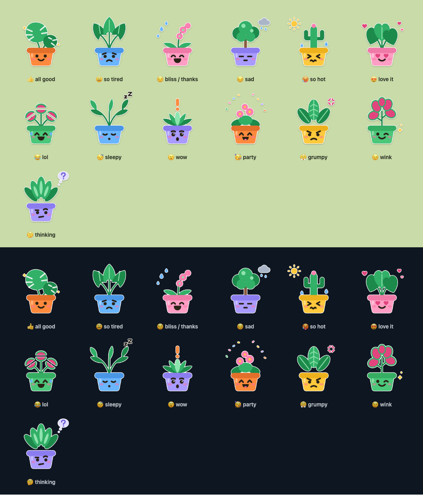
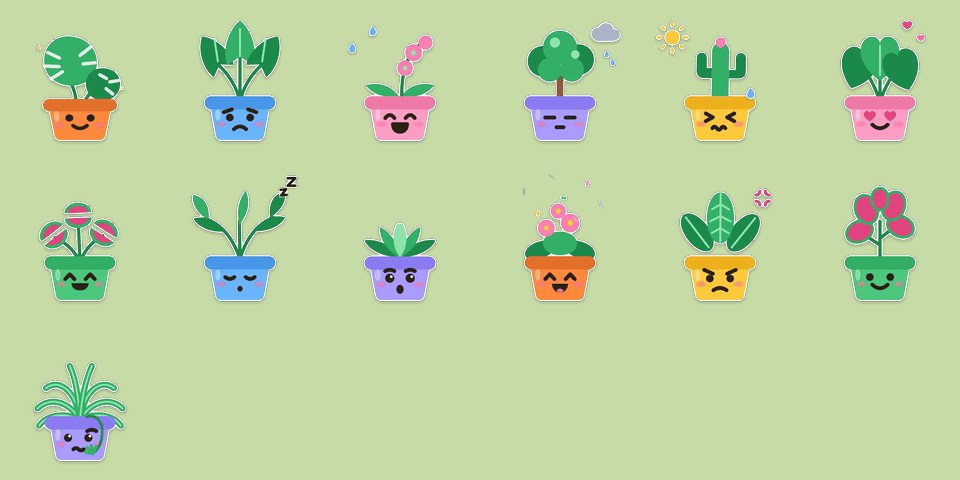

# Жунгли stickers

Telegram stickers with the plants from the [Жунгли](https://zhungli.zmoki.xyz/) app.

**Add the pack:** [t.me/addstickers/wearejungly](https://t.me/addstickers/wearejungly)





## Files

- `png/`: stickers, 512×512 with a clear background, ready for Telegram's @Stickers bot
- `svg/`: the same stickers as vector files
- `set.json`: the emoji and meaning for each sticker
- `build.js`: builds everything above and `preview.png`
- `webm/`: animated video stickers, 512×512, 24 fps, 2.9 s loop, same names and emoji as `png/`
- `animate.js`: builds `webm/` and `animated-preview.gif`

## Build

The plant drawings come from the app, so clone [zhungli](https://github.com/Zmoki/zhungli) next to this repo:

```
Projects/
  zhungli/
  zhungli-stickers/
```

Then run `node build.js` for the stickers and `node animate.js` for the animated ones. They need Node, Google Chrome (macOS path) and ffmpeg with VP9.

In @Stickers, upload `png/` with `/newpack` and `webm/` with `/newvideo`.

To add or change a sticker with Claude Code, ask for it in this repo: the `add-sticker` skill (`.claude/skills/add-sticker/`) has the style rules and steps.

## License

All rights reserved. You can send the stickers from the [official pack](https://t.me/addstickers/wearejungly) in Telegram. See [LICENSE](LICENSE).
